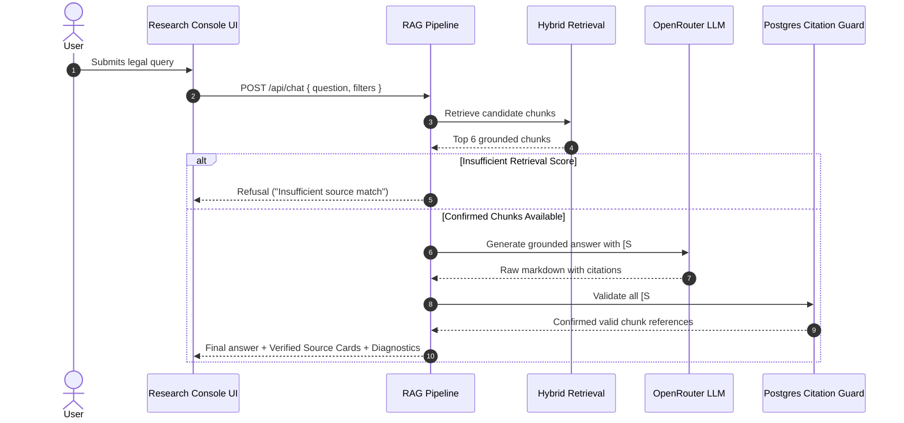

# 🏗️ Negarit (ነጋሪት) — System Architecture & Technical Specifications

> **Negarit** is a bilingual (Amharic & English) legal retrieval-augmented generation (RAG) platform designed specifically for the Ethiopian legal domain.

---

## 1. High-Level System Architecture

```
                                      ┌─────────────────────────────────────────┐
                                      │              Client Browser             │
                                      │  (Next.js 16 App Router + Tailwind CSS) │
                                      └────────────────────┬────────────────────┘
                                                           │ HTTP / JSON
                                                           ▼
┌─────────────────────────────────────────────────────────────────────────────────────────────────────────────────┐
│                                           Next.js Runtime / API Layer                                            │
│                                                                                                                 │
│   ┌─────────────────────┐   ┌──────────────────────────┐   ┌────────────────────────────────────────────────┐   │
│   │   Research Console  │   │  Admin Bento Telemetry   │   │                REST API Routes                 │   │
│   │   (/)               │   │  (/admin)                │   │  /api/{chat, search, documents, health, ...}   │   │
│   └──────────┬──────────┘   └────────────┬─────────────┘   └───────────────────────┬────────────────────────┘   │
└──────────────┼───────────────────────────┼─────────────────────────────────────────┼────────────────────────────┘
               │                           │                                         │
               └───────────────────────────┴────────────────────┬────────────────────┘
                                                                ▼
┌─────────────────────────────────────────────────────────────────────────────────────────────────────────────────┐
│                                            Server Services Subsystems                                           │
│                                                                                                                 │
│  ┌─────────────────────────┐   ┌───────────────────────────┐   ┌────────────────────────┐   ┌────────────────┐  │
│  │    Ingestion Engine     │   │      Retrieval Engine     │   │   Grounded Synthesis   │   │ Citation Guard │  │
│  │  - PDF Text Extraction  │   │  - Exact Proclamation Mtr │   │  - OpenRouter LLM      │   │  - Postgres DB │  │
│  │  - Ethiopic Segmenter   │   │  - Unicode-aware BM25     │   │  - Strict Grounding    │   │    Validator   │  │
│  │  - Bilingual Alignment  │   │  - Dense BGE-M3 Vectors   │   │  - Honest Refusal      │   │  - Page/Article│  │
│  │  - Article Chunking     │   │  - RRF Fusion (k=60)      │   │  - Bilingual Formatter │   │    Verifier    │  │
│  └───────────┬─────────────┘   └─────────────┬─────────────┘   └───────────┬────────────┘   └───────┬────────┘  │
└──────────────┼───────────────────────────────┼─────────────────────────────┼────────────────────────┼───────────┘
               │                               │                             │                        │
               ▼                               ▼                             ▼                        ▼
┌────────────────────────────────────────────────────────┐     ┌──────────────────────────────────────────────────┐
│                   Relational Storage                   │     │                 Vector Database                  │
│                PostgreSQL 17 (Drizzle ORM)             │     │                 Qdrant / PGVector                │
│                                                        │     │                                                  │
│ - Documents & Gazette Metadata                         │     │ - 1024-dimensional BGE-M3 Embeddings             │
│ - Articles & Sub-articles                              │     │ - Metadata Payloads:                             │
│ - Amharic/English Paired Chunks                        │     │     proclamation, article, jurisdiction,         │
│ - Ingestion Jobs & Telemetry Logs                      │     │     status, language, year                       │
│ - Query Sessions & Cached Embeddings                   │     │ - Cosine Distance Similarity Index               │
└────────────────────────────────────────────────────────┘     └──────────────────────────────────────────────────┘
```

---

## 2. Ingestion & Document Processing Pipeline

The ingestion pipeline (`src/server/ingestion/`) converts raw Federal Negarit Gazette PDFs into structured, cross-referenced, bilingual legal chunks.

### Step 1: Text-Layer Extraction (`pdf.ts`)
- Utilizes `pdfjs-dist` to extract structured text with page coordinate metadata.
- **Scanned PDF Guard**: Calculates the character-to-page ratio. If a PDF is a scanned image with no text layer, the system raises `ScannedPdfError` with an `OCR_REQUIRED` flag, preventing corrupted or empty indexes.

### Step 2: Language & Script Classification (`segment.ts`)
- Evaluates Unicode code points to distinguish Ethiopic Ge'ez script (`U+1200` to `U+137F`) from Latin script (`U+0000` to `U+007F`).
- Segregates bilingual documents that publish Amharic and English text on alternating pages or parallel sections.

### Step 3: Structural Legal Chunking (Not Blind Fixed-Size Slicing)
- Standard RAG systems split text by arbitrary tokens (e.g. 500 characters), which tears legal articles in half and loses legal context.
- **Negarit Legal Chunking** uses regular expressions tuned for Ethiopian legal formatting:
  - Amharic: `አንቀጽ\s+(\d+|[፩-፼])`
  - English: `Article\s+(\d+)`
- Each chunk preserves:
  - Proclamation title and number (e.g. `1396/2025`)
  - Article number and sub-article numbers (e.g. `3(1)(a)`)
  - Page number in the official gazette
  - Legal category and enactment status (`IN_FORCE`, `AMENDED`, etc.)

### Step 4: Bilingual Pairing
- Automatically matches Amharic chunks with their English counterpart for the same article.
- When viewing a citation in English, the user can click **"pair"** to view the authoritative Amharic text side-by-side, reflecting the constitutional supremacy of Amharic under Article 106 of the FDRE Constitution.

### Step 5: Vectorization & Deduplication (`embeddings/huggingface.ts`)
- Computes 1024-dimensional dense vectors using **BAAI/bge-m3**, one of the world's leading multilingual models with native support for low-resource languages and cross-lingual alignment.
- Hashes input text with SHA-256 to cache embeddings in PostgreSQL, reducing latency and avoiding redundant external API calls.

---

## 3. Hybrid Retrieval Engine (`src/server/retrieval/`)

Retrieval operates in three stages to guarantee both high recall and high precision:

```
User Query: "What is the scope of application of Proclamation 1396/2025?"
   │
   ├──▶ 1. Exact Match Router: Detects "1396/2025" and "scope" (Article 3)
   │       └─ Hits exact article in PostgreSQL metadata index
   │
   ├──▶ 2. Sparse Search: Unicode-aware BM25
   │       └─ Tokenizes query (handling Ethiopic word separators '፡' and spaces)
   │
   └──▶ 3. Dense Vector Search: BAAI/bge-m3 (1024-dim)
           └─ Searches Qdrant (or PostgreSQL cosine fallback)
   │
   ▼
4. Reciprocal Rank Fusion (RRF, k=60)
   Score = Σ 1 / (60 + rank_bm25) + 1 / (60 + rank_dense)
   │
   ▼
5. Metadata & Enactment Status Reranker
   - Prioritizes IN_FORCE over REPEALED/SUPERSEDED
   - Enforces user-selected Jurisdiction filters (Federal, Oromia, Amhara, etc.)
   │
   ▼
Top-6 Grounded Chunks Delivered to Synthesis Pipeline
```

---

## 4. Grounded Synthesis & Anti-Hallucination Guard (`src/server/rag/`)



### Citation Verification Protocol
Every citation `[S1]`, `[S2]` generated in the model's text is extracted via regex and verified against the actual database chunk records retrieved in the query session. If a model hallucinates a citation reference not present in the retrieved candidates, it is caught and stripped by `src/server/citations/validate.ts`.

---

## 5. Relational Database Schema (Drizzle ORM)

Located in `src/db/schema.ts`, the relational layer tracks:

1. **`documents`**: Legal document metadata (title, proclamation number, publication year, jurisdiction, status, file path, checksum).
2. **`document_versions`**: Historical versions, tracking amendments and repeal dates.
3. **`articles`**: Granular legal articles (`article_number`, `title_en`, `title_am`).
4. **`chunks`**: Text segments with character offsets, page number, language (`am` or `en`), and paired chunk ID.
5. **`ingestion_jobs`**: Job status (`QUEUED`, `PROCESSING`, `COMPLETED`, `FAILED`), progress percentages, and error stack traces.
6. **`chat_sessions` & `chat_messages`**: Query sessions and message histories.
7. **`retrieval_logs`**: Latency diagnostics, BM25 scores, vector distances, and fused RRF rankings for every query.
8. **`embedding_cache`**: SHA-256 key-value store for precomputed vectors.

---

## 6. Fault Tolerance & Graceful Degradation Matrix

| External Service Status | System Reaction | User Experience |
|---|---|---|
| **Qdrant Vector DB Offline** | Automatically switches to PostgreSQL pgvector cosine similarity search. | Seamless; zero downtime. |
| **Hugging Face Inference Offline** | Disables dense vectors; elevates BM25 keyword search with exact metadata routing. | UI displays BM25 status badge; answers remain cited. |
| **OpenRouter / LLM Offline** | Renders verbatim extracted source text directly from the verified gazette chunks. | Accurate source provisions displayed with page numbers. |
| **No Relevant Laws Found** | Evaluates fused confidence against `CONFIDENCE_MODERATE`. | Explicit refusal; zero fabricated legal rules. |
